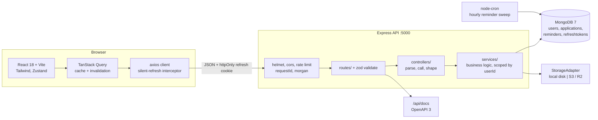
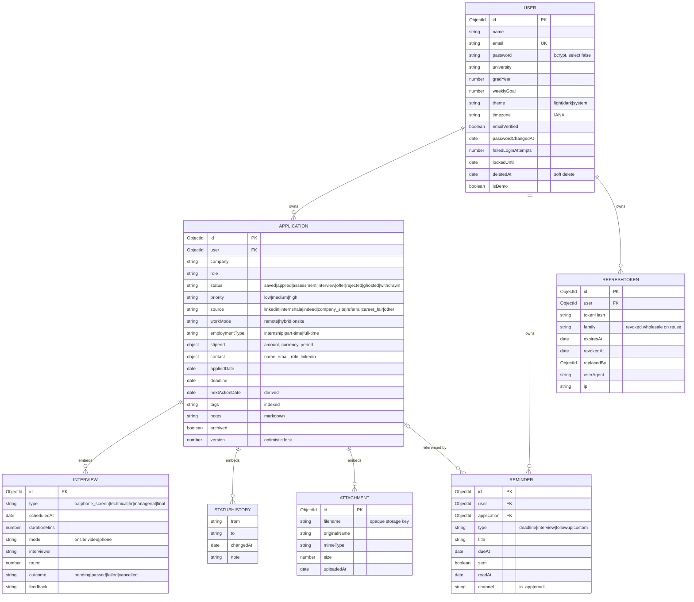

# Internship Tracker

A personal dashboard for tracking internship applications from the moment you save a posting to the
moment you get an answer. Every application moves through a real lifecycle — saved → applied →
assessment → interview → offer, rejected, ghosted or withdrawn — and the app gives you a Kanban
board, a filterable data table, a calendar of deadlines and interviews, reminders in your own
timezone, and an analytics dashboard that shows where your applications actually stall. It is
single-tenant per user, and ownership is enforced in every database query rather than only in the UI.

> **Status:** phases 1–10 of 17 complete. Auth, applications, analytics, the full front end, seed
> data, tests, docs and CI are in place. Account lifecycle (email verification, password reset),
> transactional email, the public landing page and the deployment pipeline are still to come — see
> [PROGRESS.md](PROGRESS.md) for the state of every phase.

---

## Contents

- [Features](#features)
- [Screenshots](#screenshots)
- [Tech stack](#tech-stack)
- [Architecture](#architecture)
- [Getting started](#getting-started)
- [Demo account](#demo-account)
- [Environment variables](#environment-variables)
- [npm scripts](#npm-scripts)
- [API](#api)
- [Data model](#data-model)
- [Testing](#testing)
- [Possible extensions](#possible-extensions)
- [Backups and restore](#backups-and-restore)
- [Schema migrations](#schema-migrations)

---

## Features

**Tracking**

- Full CRUD over applications with company, role, location, work mode, stipend, source, priority,
  tags, deadline, contact and markdown notes.
- Eight-stage status lifecycle. Every transition is appended to a `statusHistory` audit trail with an
  optional note, so the detail page shows a real timeline rather than a single "last updated".
- Embedded interview rounds — type, mode, scheduled time, interviewer, round number, outcome and prep
  notes — plus file attachments (PDF/DOC/DOCX/PNG/JPG) behind a pluggable storage adapter.
- Optimistic concurrency: a stale write returns `409` with the current server document, and the UI
  offers reload or overwrite instead of silently clobbering.

**Working with the list**

- Server-side pagination, sorting and eleven filters, all mirrored into the URL, so any view is
  linkable and survives a refresh.
- Debounced search across company, role, tags and notes.
- Bulk archive, unarchive, status change and delete with row selection.
- CSV import with per-row error reporting, and CSV/JSON export.

**Visual surfaces**

- Kanban board (`@dnd-kit`) with per-column counts, pointer and keyboard drag, and optimistic status
  changes that roll back on failure.
- Month calendar merging deadlines and interviews into one stream.
- Dashboard with stat cards carrying period-over-period deltas, plus timeline, status doughnut,
  by-source, funnel, top-companies and activity-heatmap visuals — all Chart.js, all re-themed live
  on a dark-mode toggle, and each duplicated as a screen-reader data table.

**Platform**

- JWT auth: a 15-minute in-memory access token plus a 7-day rotating httpOnly refresh cookie, with
  reuse detection that revokes the whole token family.
- Rate limits keyed independently on IP and email; account lock after repeated failures.
- Reminder digest cron that respects each user's own timezone across daylight-saving changes.
- Light and dark themes with no flash on first paint, a keyboard-navigable shell, focus-trapped
  modals and a WCAG-AA contrast pass.
- OpenAPI 3 spec at `/api/docs`, kept honest by a test that fails if any route is undocumented or any
  documented path no longer exists.

---

## Screenshots

> Placeholders — replace with real captures before publishing. Generate them against the seeded demo
> account (`npm run seed`, then sign in with the credentials below).

| Surface   | Image                                                      |
| --------- | ---------------------------------------------------------- |
| Dashboard | ``             |
| Board     | ``              |
| Table     | `` |
| Detail    | ``       |
| Calendar  | ``               |
| Dark mode | ``       |

---

## Tech stack

| Layer         | Choices                                                                                                                     |
| ------------- | --------------------------------------------------------------------------------------------------------------------------- |
| Runtime       | Node.js 20, TypeScript 5.7 (strict), npm workspaces monorepo                                                                |
| API           | Express 4, Mongoose 8 / MongoDB 7, zod validation at every route boundary                                                   |
| Auth          | `jsonwebtoken`, `bcryptjs` (12 rounds), rotating refresh cookies                                                            |
| API hardening | `helmet`, `cors`, `express-rate-limit`, `compression`, `cookie-parser`                                                      |
| Files         | `multer` in memory → `StorageAdapter` (`LocalDiskStorage` in dev, `S3Storage`/R2 in production), `sharp` for EXIF stripping |
| Jobs & logs   | `node-cron`, `winston`, `morgan` with request IDs                                                                           |
| Docs          | `swagger-ui-express` over a hand-written OpenAPI 3 document                                                                 |
| Front end     | React 18, Vite 6, Tailwind 3, `react-router-dom` 6                                                                          |
| Client state  | TanStack Query for all server state, Zustand for theme and session                                                          |
| Forms & UI    | `react-hook-form` + zod resolver, `react-hot-toast`, `marked` + `dompurify` for notes                                       |
| Visuals       | Chart.js 4 + `react-chartjs-2`, `@dnd-kit/core`, `date-fns`                                                                 |
| Tests         | Jest + supertest + `mongodb-memory-server` (server), Vitest + React Testing Library (client)                                |
| Tooling       | ESLint 9 + Prettier with `--max-warnings 0`, husky + lint-staged, Docker Compose, GitHub Actions                            |

---

## Architecture



Request flow in one line: **route** validates with zod → **controller** stays thin → **service** holds
the logic and takes `userId` as its first argument, so a query can never escape its owner → Mongoose →
Mongo. Errors are thrown as `ApiError` with a stable machine-readable `code` and rendered by one
central handler into the `{ success, data, message?, meta? }` envelope every endpoint uses.

---

## Getting started

**Prerequisites:** Node.js ≥ 20, and either Docker or a local MongoDB 7.

### Option A — Docker Compose (mongo + api + web, nothing else to install)

```bash
git clone https://github.com/naabelverse/internship-tracker.git
cd internship-tracker

docker compose up --build          # mongo :27017, api :5000, web :5173
docker compose exec api npm run seed -w server
```

Open <http://localhost:5173> and sign in with the [demo credentials](#demo-account).

Compose supplies the API's environment inline, so **no `.env` file is needed for this path**. It
mounts `server/src` and `client/src` for hot reload; a change to either `package.json` needs
`docker compose up --build` before it takes effect.

> Run the seed **inside** the api container, as above, so it reaches the containerised MongoDB.
> Running `npm run seed` on the host targets `127.0.0.1:27017`, which is a different database if you
> also have MongoDB installed natively — a mismatch that looks like "the seed succeeded but the
> dashboard is empty".

### Option B — npm (bring your own MongoDB)

```bash
git clone https://github.com/naabelverse/internship-tracker.git
cd internship-tracker
npm install

cp server/.env.example server/.env   # runs as-is against a local MongoDB
cp client/.env.example client/.env

npm run seed                          # demo user + 64 applications
npm run dev                           # api :5000 and web :5173 together
```

`server/.env.example` works unedited against `mongodb://127.0.0.1:27017`. The only values worth
changing for local work are `MONGO_URI` and the two JWT secrets — development tolerates weak ones,
production does not.

### Verify it came up

```bash
curl localhost:5000/health          # 200, liveness
curl localhost:5000/ready           # 200 once Mongo answers a ping
open  localhost:5000/api/docs       # OpenAPI 3 / Swagger UI
```

---

## Demo account

`npm run seed` creates one account holding 64 generated applications spread over the last six months —
every status represented, seven sources, interviews on the in-progress records, deadlines both past
and upcoming, and a populated status history behind every row, so no dashboard panel is empty.

| Field    | Value              |
| -------- | ------------------ |
| Email    | `demo@tracker.dev` |
| Password | `Demo@1234`        |

These are fixture credentials, published deliberately, and configurable via `DEMO_EMAIL` and
`DEMO_PASSWORD`. Change them on any publicly reachable instance. `npm run seed` refuses an account
that already holds applications; use `npm run seed:reset` to wipe and regenerate.

---

## Environment variables

Every variable below is read by a zod loader that validates at boot and reports **all** problems at
once. Development needs only `MONGO_URI` and the two JWT secrets; everything else falls back to the
default shown. A blank value (`KEY=`) is treated as unset, so the example files can ship optional keys
empty.

### Server (`server/.env`)

| Variable                                   | Default                 | Notes                                                                      |
| ------------------------------------------ | ----------------------- | -------------------------------------------------------------------------- |
| `NODE_ENV`                                 | `development`           | `development` \| `test` \| `production`                                    |
| `PORT`                                     | `5000`                  |                                                                            |
| `MONGO_URI`                                | —                       | **Required.** Atlas form `mongodb+srv://…` also works                      |
| `JWT_ACCESS_SECRET`                        | —                       | **Required.** ≥32 chars in production, must differ from the refresh secret |
| `JWT_REFRESH_SECRET`                       | —                       | **Required.** Same rules                                                   |
| `ACCESS_TOKEN_TTL`                         | `15m`                   | `ms`-style duration string                                                 |
| `REFRESH_TOKEN_TTL`                        | `7d`                    | `ms`-style duration string                                                 |
| `CLIENT_ORIGIN`                            | `http://localhost:5173` | CORS allow-list; rejected if localhost in production                       |
| `APP_URL`                                  | `http://localhost:5173` | Public client URL used in generated links                                  |
| `API_URL`                                  | `http://localhost:5000` | Public API origin; signed download links are built from it                 |
| `LOG_LEVEL`                                | `info`                  | `error` \| `warn` \| `info` \| `http` \| `debug`                           |
| `TRUST_PROXY`                              | `0`                     | Proxy hops to trust for client IPs; `1` behind Render or Railway           |
| `STORAGE_DRIVER`                           | `local`                 | `local` \| `s3`. Production refuses `local` — free-tier disks are wiped    |
| `UPLOAD_DIR`                               | `uploads`               | Local driver only, relative to the server workspace                        |
| `MAX_UPLOAD_MB`                            | `5`                     | Per-file ceiling                                                           |
| `S3_ENDPOINT`                              | _(unset)_               | Leave blank for AWS; set for Cloudflare R2 or another S3-compatible host   |
| `S3_REGION`, `S3_BUCKET`                   | _(unset)_               | Required when `STORAGE_DRIVER=s3`                                          |
| `S3_ACCESS_KEY_ID`, `S3_SECRET_ACCESS_KEY` | _(unset)_               | Required when `STORAGE_DRIVER=s3`                                          |
| `DEMO_EMAIL`                               | `demo@tracker.dev`      | Account created by `npm run seed`                                          |
| `DEMO_PASSWORD`                            | `Demo@1234`             | Minimum 8 characters                                                       |
| `REMINDER_DIGEST_HOUR`                     | `8`                     | Local hour at which each user receives their digest                        |
| `ENABLE_CRON`                              | `true`                  | `false` keeps the scheduler off; the test suite sets this                  |

`SENTRY_DSN` is optional and unset by default: with no DSN the SDK is never initialised, so the
server makes no outbound call and behaves exactly as it does without it. When set, only 5xx
responses are reported, request headers, cookies and bodies are stripped, and the reported user is
reduced to an id. `SENTRY_TRACES_SAMPLE_RATE` defaults to `0` — traces are billed per event and this
is a free-tier deployment, so errors are the point.

### Client (`client/.env`)

| Variable       | Default                 | Notes                                        |
| -------------- | ----------------------- | -------------------------------------------- |
| `VITE_API_URL` | `http://localhost:5000` | API base URL, no trailing slash              |
| `VITE_APP_URL` | `http://localhost:5173` | Public origin of this client, for canonicals |

> **Not yet implemented.** SPEC §8 also lists `MAIL_FROM`, `MAIL_TRANSPORT`, `SMTP_*`, `SENTRY_DSN`,
> `COOKIE_DOMAIN`, `CONTACT_EMAIL`, `VITE_DEMO_ENABLED`, `VITE_SENTRY_DSN` and `VITE_ANALYTICS_*`.
> Nothing reads them yet, so by project convention each lands in `.env.example` in the phase that
> consumes it — mail in phase 12, the demo toggle and analytics in phase 13, Sentry in phase 14,
> `COOKIE_DOMAIN` in phase 16. The tables above are the complete set that exists today.

---

## npm scripts

Run from the repository root unless noted.

| Script                  | What it does                                                     |
| ----------------------- | ---------------------------------------------------------------- |
| `npm run dev`           | API and client together with hot reload                          |
| `npm run build`         | Type-checked build of both workspaces                            |
| `npm run lint`          | ESLint with `--max-warnings 0`, then `prettier --check`          |
| `npm run lint:fix`      | ESLint autofix                                                   |
| `npm run format`        | Prettier write                                                   |
| `npm run typecheck`     | `tsc --noEmit` in both workspaces                                |
| `npm run test`          | Jest (server), then Vitest (client)                              |
| `npm run test:coverage` | Server tests with the coverage report, enforcing the §10 target  |
| `npm run verify`        | lint → typecheck → test → build. **Must pass before any commit** |
| `npm run seed`          | Create the demo account and its 64 applications                  |
| `npm run seed:reset`    | Wipe the demo account's data and reseed                          |
| `npm run migrate`       | Apply pending schema migrations (see below)                      |

Plus `./scripts/backup.sh`, which is a shell script rather than an npm script on purpose: a backup
has to run from cron on a host that has never installed this project's dependencies.

Workspace-only extras: `npm run test:watch -w server`, `npm run test:watch -w client`,
`npm run preview -w client`, and `npm run start -w server` to run the compiled `dist/`.

---

## API

Base path `/api/v1`. Every response uses the `{ success, data, message?, meta? }` envelope and every
error carries a stable `code`. All application, analytics, calendar and reminder routes require a
bearer access token and are scoped to the caller.

Interactive docs live at **`/api/docs`**. The table below mirrors the same router that document
describes: a test walks the Express stack in both directions and fails if a route is undocumented or a
documented path has gone stale, so the OpenAPI spec, this table and the code cannot drift apart.

| Method   | Path                                          | Purpose                                           |
| -------- | --------------------------------------------- | ------------------------------------------------- |
| `GET`    | `/health`, `/ready`                           | Liveness and readiness probes                     |
| `POST`   | `/auth/register`                              | Create an account, set the refresh cookie         |
| `POST`   | `/auth/login`                                 | Sign in                                           |
| `POST`   | `/auth/refresh`                               | Rotate the refresh token, mint an access token    |
| `POST`   | `/auth/logout`                                | Revoke the current refresh token                  |
| `POST`   | `/auth/logout-all`                            | Revoke every session for the account              |
| `GET`    | `/auth/me`                                    | Current account                                   |
| `PATCH`  | `/auth/me`                                    | Update profile and preferences                    |
| `PATCH`  | `/auth/me/password`                           | Change password, revoke other sessions            |
| `GET`    | `/applications`                               | List — filters, search, sort, pagination          |
| `POST`   | `/applications`                               | Create                                            |
| `GET`    | `/applications/:id`                           | Read one                                          |
| `PATCH`  | `/applications/:id`                           | Update, optimistic-locked by `version`            |
| `DELETE` | `/applications/:id`                           | Delete                                            |
| `PATCH`  | `/applications/:id/status`                    | Change status, append to `statusHistory`          |
| `POST`   | `/applications/bulk`                          | Bulk delete, archive, unarchive, set status       |
| `GET`    | `/applications/export`                        | Download CSV or JSON                              |
| `POST`   | `/applications/import`                        | CSV import with per-row errors                    |
| `POST`   | `/applications/demo-data`                     | Fill an empty account with the fixture set        |
| `POST`   | `/applications/:id/interviews`                | Add an interview round                            |
| `PATCH`  | `/applications/:id/interviews/:interviewId`   | Update a round                                    |
| `DELETE` | `/applications/:id/interviews/:interviewId`   | Remove a round                                    |
| `POST`   | `/applications/:id/attachments`               | Upload a file                                     |
| `GET`    | `/applications/:id/attachments/:attachmentId` | Mint a signed, expiring download URL              |
| `DELETE` | `/applications/:id/attachments/:attachmentId` | Delete a file                                     |
| `GET`    | `/analytics/summary`                          | Counts, rates, streak, weekly goal, period delta  |
| `GET`    | `/analytics/status-breakdown`                 | Count per status, empty statuses included         |
| `GET`    | `/analytics/timeline`                         | Created and status changes, by day, week or month |
| `GET`    | `/analytics/by-source`                        | Count per source                                  |
| `GET`    | `/analytics/funnel`                           | Applied → assessment → interview → offer          |
| `GET`    | `/analytics/top-companies`                    | Most-applied-to companies                         |
| `GET`    | `/calendar`                                   | Deadlines and interviews in a date window         |
| `GET`    | `/reminders`                                  | List reminders                                    |
| `POST`   | `/reminders`                                  | Create a reminder                                 |
| `PATCH`  | `/reminders/:id/read`                         | Mark read                                         |
| `DELETE` | `/reminders/:id`                              | Delete                                            |
| `GET`    | `/files/*`                                    | Serve a stored object against a signed URL        |

---

## Data model



Compound indexes on `{ user, status }` and `{ user, deadline }`, plus a text index across
`company, role, notes, tags`. Timestamps are stored in UTC everywhere; every user-facing day, week and
streak boundary is resolved through the account's IANA timezone.

---

## Testing

```bash
npm run test            # server (Jest) then client (Vitest)
npm run test:coverage   # server coverage report
```

The server suite runs against `mongodb-memory-server`, so it needs no running database. Coverage is
enforced rather than merely reported: `server/jest.config.js` fails the run if `src/services` or
`src/controllers` falls below the 70% statement target from SPEC §10. Both currently sit near 98%.

Guarantees worth knowing are under test: user A cannot read user B's data through any endpoint;
refresh-token reuse revokes the whole family; a password change invalidates access tokens minted in
the same second; analytics day and week boundaries are correct for two distant timezones; the seed
produces a genuine six-month spread rather than one day's worth of rows; and the OpenAPI document
matches the router exactly in both directions.

End-to-end Playwright flows and the axe accessibility sweep arrive in phase 15.

---

## Possible extensions

- **Google OAuth sign-in**, linking to an existing account by verified email.
- **Browser extension or bookmarklet** that saves a posting straight from LinkedIn or a careers page,
  with company, role and URL pre-filled.
- **Resume versioning** — attach the exact CV sent per application, and report which version
  correlates with responses.
- **Email ingestion**: forward rejection and interview-invite emails to a per-user address and let a
  parser advance the status automatically.
- **Cohort benchmarking**: anonymised, opt-in comparison of response rates by company and source.
- **Follow-up nudges** that suggest when to chase an application that has gone quiet, based on the
  observed response-time distribution.
- **Offer comparison view** — stipend, location, team and deadline side by side once more than one
  offer lands.
- **iCal feed** of deadlines and interviews for Google or Apple Calendar.
- **Saved filter presets** and a weekly email digest of the board's state.

---

## Backups and restore

`./scripts/backup.sh` writes a single gzipped `mongodump` archive to `backups/`, keeping the last
14 by default. It reads `MONGO_URI` from the environment, falling back to `server/.env`, and never
echoes it — a connection string carries the database password and a cron log is not a place to
leave one. The script needs only the
[MongoDB Database Tools](https://www.mongodb.com/docs/database-tools/installation/), not this
project's dependencies, so it can run on a host that has never checked the repository out.

```bash
./scripts/backup.sh                             # ./backups, keep 14 days
BACKUP_DIR=/var/backups RETAIN_DAYS=30 ./scripts/backup.sh
```

Old archives are pruned only **after** a successful dump, so a failed run never destroys the last
good copy on its way out, and an empty archive is deleted and reported as a failure rather than
counted as a backup.

Nightly at 03:00, via cron:

```cron
0 3 * * * cd /srv/internship-tracker && BACKUP_DIR=/var/backups ./scripts/backup.sh >> /var/log/tracker-backup.log 2>&1
```

### Restoring

```bash
# Inspect first — this lists the collections in the archive without writing anything.
mongorestore --archive=backups/internship-tracker-2026-09-05T03-00-00Z.archive.gz --gzip --dryRun -v

# Restore into a scratch database and check it before going near the live one.
mongorestore --uri="$MONGO_URI" --archive=backups/<file>.archive.gz --gzip   --nsFrom='internship_tracker.*' --nsTo='internship_tracker_restore.*'

# Only once that looks right, replace the live database.
mongorestore --uri="$MONGO_URI" --archive=backups/<file>.archive.gz --gzip --drop
```

`--drop` empties each collection in the archive before restoring it, which is what makes the result
match the backup rather than merge with whatever is there. It does **not** remove collections that
are absent from the archive, so a collection added after the backup survives. Run `npm run migrate`
after any restore: an older archive can hold documents at an older `schemaVersion`.

**Atlas free tier.** M0 clusters have no automated backups — the setting only appears from M10 up.
Until then this script is the backup, and it needs to run somewhere that is not the database host.
On a paid tier, enable _Cloud Backup_ under the cluster's **Backup** tab and keep this script as the
off-provider copy.

---

## Schema migrations

`schemaVersion` on `User` and `Application` records which shape a document is in. Once real users
exist you cannot change a schema by editing the model alone, so the mechanism exists before launch.

```bash
npm run migrate    # applies everything this database has not seen, oldest first
```

Migrations live in `server/src/migrations/` as `NNN-what-it-does.ts` and are listed in
`index.ts`. Each records itself in a `migrations` collection with a unique version, so:

- a run applies only what is pending, in ascending order;
- a second instance racing the first loses the ledger insert and stops;
- a failure aborts the run with its ledger row unwritten, so the next attempt retries that
  migration rather than skipping past it.

Run it **before** starting the new server version, not from inside it: a migration that has to
finish before the new code is correct must not be competing with that code for the same documents.

Writing one: add the new fields to the model as optional, bump `CURRENT_*_SCHEMA_VERSION`, and write
a migration that selects on the old `schemaVersion`, writes the new fields and stamps the new
version. Selecting on the version is what makes a re-run harmless — the second pass matches nothing.
`001-backfill-schema-version.ts` is the worked example.

---

## Repository documents

| File                         | Contents                                                       |
| ---------------------------- | -------------------------------------------------------------- |
| [SPEC.md](SPEC.md)           | Full product and technical specification — the source of truth |
| [PROGRESS.md](PROGRESS.md)   | Phase-by-phase build status                                    |
| [DECISIONS.md](DECISIONS.md) | Every assumption made during the build, with reasons           |
| [CLAUDE.md](CLAUDE.md)       | Working conventions for this repository                        |

## License

MIT.
