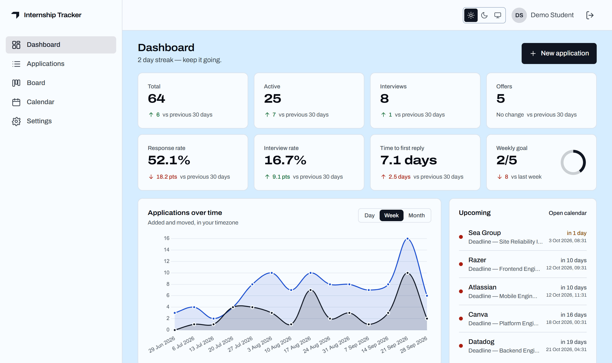
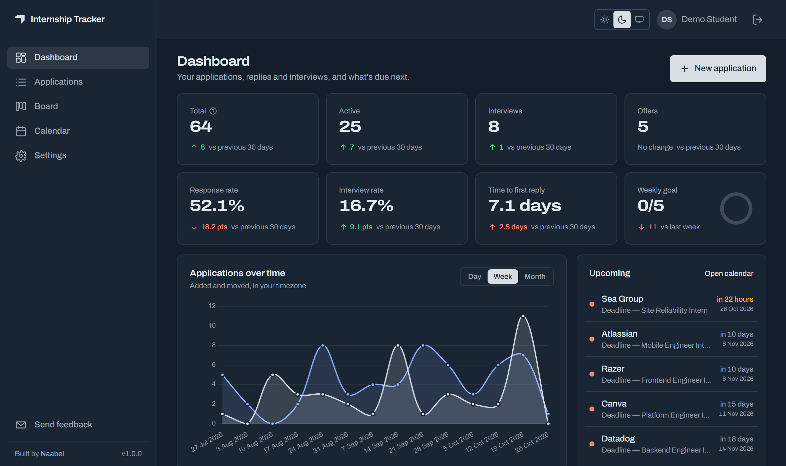
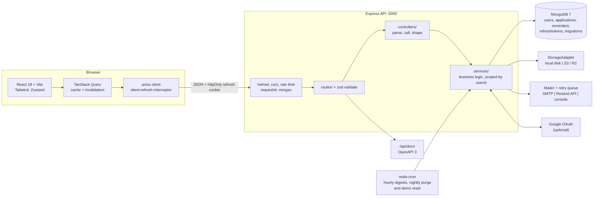
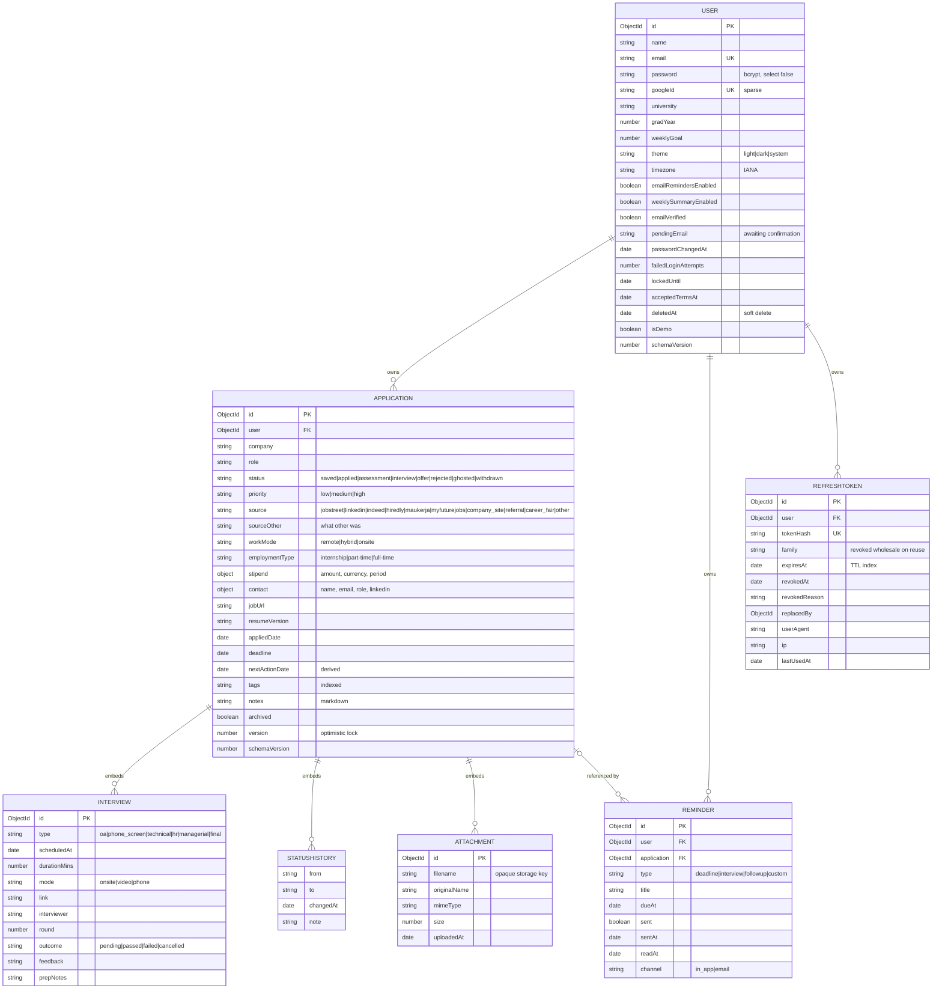

# Internship Tracker

A personal dashboard for tracking internship applications from the moment you save a posting to the
moment you get an answer. Every application moves through a real lifecycle — saved → applied →
assessment → interview → offer, rejected, ghosted or withdrawn — and the app gives you a Kanban
board, a filterable data table, a calendar of deadlines and interviews, reminders in your own
timezone, and an analytics dashboard that shows where your applications actually stall. It is
single-tenant per user, and ownership is enforced in every database query rather than only in the UI.

> **Live:** <https://internship-tracker-by-naabel.up.railway.app/> — press **Try the demo** to look
> around without signing up.
>
> **Status:** all 17 phases of [SPEC.md](SPEC.md) are complete, including the optional Google
> sign-in, and the app runs in production on Railway with MongoDB Atlas, an S3-compatible bucket
> and Resend for email. Every green commit on `main` deploys automatically. See
> [PROGRESS.md](PROGRESS.md) for what each phase delivered and [CHANGELOG.md](CHANGELOG.md) for
> what changed since.

---

## Contents

- [Features](#features)
- [Screenshots](#screenshots)
- [Tech stack](#tech-stack)
- [Architecture](#architecture)
- [Getting started](#getting-started)
- [Demo account](#demo-account)
- [Environment variables](#environment-variables)
- [npm scripts](#npm-scripts)
- [API](#api)
- [Data model](#data-model)
- [Testing](#testing)
- [Performance](#performance)
- [Deployment](#deployment)
- [Backups and restore](#backups-and-restore)
- [Schema migrations](#schema-migrations)
- [Possible extensions](#possible-extensions)
- [Repository documents](#repository-documents)
- [License](#license)

---

## Features

**Tracking**

- Full CRUD over applications with company, role, location, work mode, stipend, source, priority,
  tags, deadline, contact and markdown notes.
- Eight-stage status lifecycle. Every transition is appended to a `statusHistory` audit trail with an
  optional note, so the detail page shows a real timeline rather than a single "last updated".
- Embedded interview rounds — type, mode, scheduled time, interviewer, round number, outcome and prep
  notes — plus file attachments (PDF/DOC/DOCX/PNG/JPG) behind a pluggable storage adapter.
- Optimistic concurrency: a stale write returns `409` with the current server document, and the UI
  offers reload or overwrite instead of silently clobbering.

**Working with the list**

- Server-side pagination, sorting and eleven filters, all mirrored into the URL, so any view is
  linkable and survives a refresh.
- Debounced search across company, role, tags and notes.
- Bulk archive, unarchive, status change and delete with row selection.
- CSV import with per-row error reporting, and CSV/JSON export. Export CSV offers the table's
  shown columns or all fields.

**Visual surfaces**

- Kanban board (`@dnd-kit`) with per-column counts, pointer and keyboard drag, and optimistic status
  changes that roll back on failure.
- Month calendar merging deadlines and interviews into one stream.
- Dashboard with stat cards carrying period-over-period deltas, plus timeline, status doughnut,
  by-source, funnel and top-companies charts — all Chart.js, all re-themed live on a dark-mode
  toggle, and each duplicated as a screen-reader data table — and a 12-week activity heatmap with
  weekly pace measured against your own weekly goal.

**Accounts**

- JWT auth: a 15-minute in-memory access token plus a 7-day rotating httpOnly refresh cookie, with
  reuse detection that revokes the whole token family.
- Email verification, forgot and reset password (the response is identical whether or not the
  address exists), and email change confirmed at the new address. Every token is single-use,
  expiring and stored only as a hash.
- A list of signed-in devices, each revocable, plus "sign out everywhere".
- Closing an account soft-deletes it; it can be restored within 30 days, after which a nightly job
  purges it. A full JSON export of everything stored about the account is one click in Settings.
- Optional "Continue with Google", off until the deployment configures an OAuth client.
- "Try the demo" on the landing page signs into a shared sandbox account. Its password, shared
  profile and the account itself cannot be changed or closed, and its data is reseeded every night.

**Email**

- Six templates, each responsive HTML plus plain text, sent through SMTP or Resend's HTTP API with a
  retry queue — a failed send never fails the HTTP request. With no provider configured the app
  falls back to printing mail to the console, so it boots and registers with no email setup at all.
- A daily reminder digest and an opt-in weekly summary, both delivered at a set hour in each user's
  own timezone across daylight-saving changes, with a signed one-click unsubscribe.

**Platform**

- Rate limits keyed independently on IP and email; account lock after repeated failures; a
  disposable-email blocklist and a honeypot on registration; per-account caps of 2,000
  applications, 20 attachments per application and 100 MB of uploads.
- Uploads are type-checked, EXIF-stripped and stored under opaque keys; downloads go through signed,
  expiring URLs.
- A public landing page, Terms and Privacy pages, and full SEO metadata — Open Graph image,
  sitemap, robots, manifest and favicons.
- Light and dark themes with no flash on first paint, a keyboard-navigable shell, focus-trapped
  modals and a WCAG-AA contrast pass enforced by a test over every colour token.
- OpenAPI 3 spec at `/api/docs`, kept honest by a test that fails if any route is undocumented or any
  documented path no longer exists.

---

## Screenshots

The dashboard, signed in as the seeded demo account. These are the same captures the landing page
shows, regenerated with `npm run screenshot -w client` whenever the dashboard changes.





---

## Tech stack

| Layer         | Choices                                                                                                                     |
| ------------- | --------------------------------------------------------------------------------------------------------------------------- |
| Runtime       | Node.js 20, TypeScript 5.7 (strict), npm workspaces monorepo                                                                |
| API           | Express 4, Mongoose 8 / MongoDB 7, zod 4 validation at every route boundary                                                 |
| Auth          | `jsonwebtoken`, `bcryptjs` (12 rounds), rotating refresh cookies, `passport-google-oauth20` for the optional Google sign-in |
| API hardening | `helmet`, `cors`, `express-rate-limit`, `compression`, `cookie-parser`                                                      |
| Files         | `multer` in memory → `StorageAdapter` (`LocalDiskStorage` in dev, `S3Storage`/R2 in production), `sharp` for EXIF stripping |
| Email         | `nodemailer` over SMTP, or Resend's HTTP API where outbound SMTP is blocked, with a console fallback                        |
| Jobs & logs   | `node-cron`, `winston`, `morgan` with request IDs, optional Sentry on both server and client                                |
| Docs          | `swagger-ui-express` over a hand-written OpenAPI 3 document                                                                 |
| Front end     | React 18, Vite 6, Tailwind 3, `react-router-dom` 7, `react-helmet-async` for per-route head tags                            |
| Client state  | TanStack Query 5 for all server state, Zustand for theme and session                                                        |
| Forms & UI    | `react-hook-form` + zod resolver, `react-day-picker`, `react-hot-toast`, `marked` + `dompurify` for notes                   |
| Visuals       | Chart.js 4 + `react-chartjs-2`, `@dnd-kit/core`, `date-fns`                                                                 |
| Tests         | Jest + supertest + `mongodb-memory-server` (server), Vitest 5 + React Testing Library (client), Playwright + axe (E2E)      |
| Tooling       | ESLint 9 + Prettier with `--max-warnings 0`, husky + lint-staged, Docker Compose, GitHub Actions                            |

---

## Architecture



Request flow in one line: **route** validates with zod → **controller** stays thin → **service** holds
the logic and takes `userId` as its first argument, so a query can never escape its owner → Mongoose →
Mongo. Errors are thrown as `ApiError` with a stable machine-readable `code` and rendered by one
central handler into the `{ success, data, message?, meta? }` envelope every endpoint uses.

---

## Getting started

**Prerequisites:** Node.js ≥ 20, and either Docker or a local MongoDB 7.

### Option A — Docker Compose (mongo + api + web, nothing else to install)

```bash
git clone https://github.com/naabelverse/internship-tracker.git
cd internship-tracker

docker compose up --build          # mongo :27017, api :5000, web :5173
docker compose exec api npm run seed -w server
```

Open <http://localhost:5173> and sign in with the [demo credentials](#demo-account).

Compose supplies the API's environment inline, so **no `.env` file is needed for this path**. It
mounts `server/src` and `client/src` for hot reload; a change to either `package.json` needs
`docker compose up --build` before it takes effect.

> Run the seed **inside** the api container, as above, so it reaches the containerised MongoDB.
> Running `npm run seed` on the host targets `127.0.0.1:27017`, which is a different database if you
> also have MongoDB installed natively — a mismatch that looks like "the seed succeeded but the
> dashboard is empty".

### Option B — npm (bring your own MongoDB)

```bash
git clone https://github.com/naabelverse/internship-tracker.git
cd internship-tracker
npm install

cp server/.env.example server/.env   # runs as-is against a local MongoDB
cp client/.env.example client/.env

npm run seed                          # demo user + 64 applications
npm run dev                           # api :5000 and web :5173 together
```

`server/.env.example` works unedited against `mongodb://127.0.0.1:27017`. The only values worth
changing for local work are `MONGO_URI` and the two JWT secrets — development tolerates weak ones,
production does not.

### Verify it came up

```bash
curl localhost:5000/health          # 200, liveness
curl localhost:5000/ready           # 200 once Mongo answers a ping
open  localhost:5000/api/docs       # OpenAPI 3 / Swagger UI
```

---

## Demo account

`npm run seed` creates one account holding 64 generated applications spread over the last six months —
all eight statuses and all ten sources represented, interviews on the in-progress records, deadlines
both past and upcoming, and a populated status history behind every row, so no dashboard panel is
empty.

| Field    | Value              |
| -------- | ------------------ |
| Email    | `demo@tracker.dev` |
| Password | `Demo@1234`        |

These are fixture credentials, published deliberately, and configurable via `DEMO_EMAIL` and
`DEMO_PASSWORD`. Change them on any publicly reachable instance. `npm run seed` refuses an account
that already holds applications; use `npm run seed:reset` to wipe and regenerate.

The landing page's **Try the demo** button signs into this same account without a password, through
`POST /auth/demo`, which takes no body and can reach no other account. Changing its password or
shared profile fields, and closing it, are refused there, and a nightly job runs the same reset as
`npm run seed:reset` at 04:20 UTC so a visitor's edits never outlive the day.
`VITE_DEMO_ENABLED=false` hides the button.

---

## Environment variables

Every variable below is read by a zod loader that validates at boot and reports **all** problems at
once. Development needs only `MONGO_URI` and the two JWT secrets; everything else falls back to the
default shown. A blank value (`KEY=`) is treated as unset, so the example files can ship optional keys
empty.

### Server (`server/.env`)

| Variable                                   | Default                                   | Notes                                                                         |
| ------------------------------------------ | ----------------------------------------- | ----------------------------------------------------------------------------- |
| `NODE_ENV`                                 | `development`                             | `development` \| `test` \| `production`                                       |
| `PORT`                                     | `5000`                                    |                                                                               |
| `MONGO_URI`                                | —                                         | **Required.** Atlas form `mongodb+srv://…` also works                         |
| `JWT_ACCESS_SECRET`                        | —                                         | **Required.** ≥32 chars in production, must differ from the refresh secret    |
| `JWT_REFRESH_SECRET`                       | —                                         | **Required.** Same rules                                                      |
| `ACCESS_TOKEN_TTL`                         | `15m`                                     | `ms`-style duration string                                                    |
| `REFRESH_TOKEN_TTL`                        | `7d`                                      | `ms`-style duration string                                                    |
| `CLIENT_ORIGIN`                            | `http://localhost:5173`                   | CORS allow-list; rejected if localhost in production                          |
| `APP_URL`                                  | `http://localhost:5173`                   | Public client URL used in generated links                                     |
| `API_URL`                                  | `http://localhost:5000`                   | Public API origin; signed download links are built from it                    |
| `LOG_LEVEL`                                | `info`                                    | `error` \| `warn` \| `info` \| `http` \| `debug`                              |
| `TRUST_PROXY`                              | `0`                                       | Proxy hops to trust for client IPs; `1` behind Render or Railway              |
| `STORAGE_DRIVER`                           | `local`                                   | `local` \| `s3`. Production refuses `local` — free-tier disks are wiped       |
| `UPLOAD_DIR`                               | `uploads`                                 | Local driver only, relative to the server workspace                           |
| `MAX_UPLOAD_MB`                            | `5`                                       | Per-file ceiling                                                              |
| `S3_ENDPOINT`                              | _(unset)_                                 | Leave blank for AWS; set for Cloudflare R2 or another S3-compatible host      |
| `S3_REGION`, `S3_BUCKET`                   | _(unset)_                                 | Required when `STORAGE_DRIVER=s3`                                             |
| `S3_ACCESS_KEY_ID`, `S3_SECRET_ACCESS_KEY` | _(unset)_                                 | Required when `STORAGE_DRIVER=s3`                                             |
| `DEMO_EMAIL`                               | `demo@tracker.dev`                        | Account created by `npm run seed`                                             |
| `DEMO_PASSWORD`                            | `Demo@1234`                               | Minimum 8 characters                                                          |
| `REMINDER_DIGEST_HOUR`                     | `8`                                       | Local hour at which each user receives their digest                           |
| `ENABLE_CRON`                              | `true`                                    | `false` keeps the scheduler off; the test suite sets this                     |
| `COOKIE_DOMAIN`                            | _(unset)_                                 | Leave blank for a host-only refresh cookie, which the split-host deploy wants |
| `MAIL_FROM`                                | `Internship Tracker <no-reply@localhost>` | From header; use a domain with SPF/DKIM/DMARC set up                          |
| `MAIL_TRANSPORT`                           | _(unset)_                                 | `smtp` \| `console` \| `resend-api`. Unset picks from the credential present  |
| `SMTP_HOST`, `SMTP_USER`, `SMTP_PASS`      | _(unset)_                                 | With these and `RESEND_API_KEY` blank, mail is printed to the console         |
| `SMTP_PORT`                                | `587`                                     | `465` is implicit TLS; `587` and `25` upgrade with STARTTLS                   |
| `RESEND_API_KEY`                           | _(unset)_                                 | For `resend-api`, which sends over HTTPS where SMTP ports are blocked         |
| `WEEKLY_SUMMARY_WEEKDAY`                   | `1`                                       | ISO weekday for the opt-in weekly summary, `1` Monday to `7` Sunday           |
| `SENTRY_DSN`                               | _(unset)_                                 | Unset means the SDK is never initialised                                      |
| `SENTRY_TRACES_SAMPLE_RATE`                | `0`                                       | `0` to `1`; errors only by default                                            |
| `GOOGLE_CLIENT_ID`, `GOOGLE_CLIENT_SECRET` | _(unset)_                                 | Set both or neither; the server refuses to boot with one                      |

With Sentry on, only 5xx responses are reported, request headers, cookies and bodies are stripped,
and the reported user is reduced to an id. Traces default to `0` because they are billed per event
and this is a free-tier deployment, so errors are the point.

### Client (`client/.env`)

Read at build time and baked into the bundle, so never put a secret here.

| Variable                   | Default                 | Notes                                                          |
| -------------------------- | ----------------------- | -------------------------------------------------------------- |
| `VITE_API_URL`             | `http://localhost:5000` | API base URL, no trailing slash                                |
| `VITE_APP_URL`             | `http://localhost:5173` | Public origin of this client, for canonicals and the sitemap   |
| `VITE_DEMO_ENABLED`        | `true`                  | `false` hides "Try the demo"; the API is still the real gate   |
| `VITE_GOOGLE_AUTH_ENABLED` | `false`                 | `true` shows "Continue with Google" once the API is configured |
| `VITE_SENTRY_DSN`          | _(unset)_               | Unset means the Sentry SDK is never downloaded                 |

> These tables cover every variable the code reads, and the zod loader in
> `server/src/config/env.ts` refuses to boot on an invalid one. Every variable SPEC §8 lists
> exists, with two deliberate exceptions: `CONTACT_EMAIL` is a client build-time constant in
> `client/src/lib/siteMeta.ts` rather than a server variable, because only client-rendered surfaces
> consume it; and `VITE_ANALYTICS_DOMAIN`/`VITE_ANALYTICS_SRC` were dropped because no analytics
> is used. [DECISIONS.md](DECISIONS.md) records why.
>
> For the production values — and for the cross-origin cookie configuration a split-host deploy
> needs — see [DEPLOYMENT.md](DEPLOYMENT.md).

---

## npm scripts

Run from the repository root unless noted.

| Script                            | What it does                                                                               |
| --------------------------------- | ------------------------------------------------------------------------------------------ |
| `npm run dev`                     | API and client together with hot reload                                                    |
| `npm run build`                   | Type-checked build of both workspaces                                                      |
| `npm run lint`                    | ESLint with `--max-warnings 0`, then `prettier --check`                                    |
| `npm run lint:fix`                | ESLint autofix                                                                             |
| `npm run format`                  | Prettier write                                                                             |
| `npm run format:check`            | Prettier check only                                                                        |
| `npm run typecheck`               | `tsc --noEmit` in both workspaces and the E2E suite                                        |
| `npm run test`                    | Jest (server), then Vitest (client)                                                        |
| `npm run test:coverage`           | Server tests with the coverage report, enforcing the §10 target                            |
| `npm run verify`                  | lint → typecheck → test → build → check:bundle. **Must pass before any commit**            |
| `npm run seed`                    | Create the demo account and its 64 applications                                            |
| `npm run seed:reset`              | Wipe the demo account's data and reseed                                                    |
| `npm run migrate`                 | Apply pending schema migrations (see below)                                                |
| `npm run stats`                   | Active and soft-deleted users, applications, and 7-day signups in the `MONGO_URI` database |
| `npm run storage:sweep -w server` | Dry run of the one-off orphaned-upload sweep; see DEPLOYMENT.md §10.4                      |
| `npm run e2e:up`                  | Build and start the isolated end-to-end stack (5174 / 5001)                                |
| `npm run test:e2e`                | Playwright: the ten flows, axe, and the layout audits                                      |
| `npm run e2e:down`                | Stop that stack and drop its volume                                                        |
| `npm run e2e:logs`                | Print the E2E API log, where mail tokens are printed                                       |
| `npm run analyze`                 | `vite-bundle-visualizer` treemap of the client bundle                                      |
| `npm run check:bundle`            | Route bundle sizes against the SPEC §12 budget                                             |

Plus `./scripts/backup.sh`, which is a shell script rather than an npm script on purpose: a backup
has to run from cron on a host that has never installed this project's dependencies.

Workspace-only extras: `npm run test:watch -w server`, `npm run test:watch -w client`,
`npm run preview -w client`, `npm run start -w server` to run the compiled `dist/`, and
`npm run build:deploy -w client` — a `build` that then strips the source maps out of `dist/`,
which is what a public host should be given. See [DEPLOYMENT.md](DEPLOYMENT.md).

Generators: `npm run generate:theme -w client` writes the theme CSS from
`client/src/theme/tokens.json`, `npm run assets -w client` regenerates the favicons, icons and OG
image, and `npm run mail:palette -w server` derives the email colours from the same tokens — each
has a test that fails when its committed output falls behind. `npm run screenshot -w client`
recaptures the landing page's dashboard screenshots, and has to be re-run by hand after a dashboard
change.

---

## API

Base path `/api/v1`. Every response uses the `{ success, data, message?, meta? }` envelope and every
error carries a stable `code`. Application, analytics, calendar and reminder routes require a bearer
access token and are scoped to the caller. Once the seven-day grace period after sign-up has passed,
an unverified account's writes to application and reminder routes are refused with
`EMAIL_UNVERIFIED`; its reads stay open.

Interactive docs live at **`/api/docs`**. A test walks the Express stack in both directions and fails
if a route is undocumented or a documented path has gone stale, so the OpenAPI document and the code
cannot drift apart. The table below is written by hand from the same router — `/api/docs` is the
authority if they ever disagree.

| Method   | Path                                          | Purpose                                                  |
| -------- | --------------------------------------------- | -------------------------------------------------------- |
| `GET`    | `/health`, `/ready`                           | Liveness and readiness probes (also at the root)         |
| `POST`   | `/auth/register`                              | Create an account, set the refresh cookie                |
| `POST`   | `/auth/login`                                 | Sign in                                                  |
| `POST`   | `/auth/restore`                               | Restore a closed account within 30 days                  |
| `POST`   | `/auth/demo`                                  | Sign in to the shared demo account                       |
| `GET`    | `/auth/google`, `/auth/google/callback`       | Start and finish "Continue with Google"                  |
| `POST`   | `/auth/refresh`                               | Rotate the refresh token, mint an access token           |
| `POST`   | `/auth/logout`                                | Revoke the current refresh token                         |
| `POST`   | `/auth/logout-all`                            | Revoke every session for the account                     |
| `GET`    | `/auth/me`                                    | Current account                                          |
| `PATCH`  | `/auth/me`                                    | Update profile and preferences, or start an email change |
| `DELETE` | `/auth/me`                                    | Close the account (soft delete, purged after 30 days)    |
| `PATCH`  | `/auth/me/password`                           | Change password, revoke other sessions                   |
| `GET`    | `/auth/me/export`                             | Download everything stored about the account             |
| `GET`    | `/auth/me/usage`                              | Usage against the per-account resource caps              |
| `POST`   | `/auth/verify-email`                          | Confirm an email address with the emailed token          |
| `POST`   | `/auth/resend-verification`                   | Send a new confirmation link                             |
| `POST`   | `/auth/forgot-password`                       | Request a reset link — same answer for any email         |
| `POST`   | `/auth/reset-password`                        | Set a new password with a reset token                    |
| `GET`    | `/auth/sessions`                              | List the signed-in devices                               |
| `DELETE` | `/auth/sessions/:id`                          | Sign one device out                                      |
| `GET`    | `/applications`                               | List — filters, search, sort, pagination                 |
| `POST`   | `/applications`                               | Create                                                   |
| `GET`    | `/applications/:id`                           | Read one                                                 |
| `PATCH`  | `/applications/:id`                           | Update, optimistic-locked by `version`                   |
| `DELETE` | `/applications/:id`                           | Delete                                                   |
| `PATCH`  | `/applications/:id/status`                    | Change status, append to `statusHistory`                 |
| `POST`   | `/applications/bulk`                          | Bulk delete, archive, unarchive, set status              |
| `GET`    | `/applications/export`                        | Download CSV or JSON                                     |
| `POST`   | `/applications/import`                        | CSV import with per-row errors                           |
| `POST`   | `/applications/demo-data`                     | Fill an empty account with the fixture set               |
| `POST`   | `/applications/:id/interviews`                | Add an interview round                                   |
| `PATCH`  | `/applications/:id/interviews/:interviewId`   | Update a round                                           |
| `DELETE` | `/applications/:id/interviews/:interviewId`   | Remove a round                                           |
| `POST`   | `/applications/:id/attachments`               | Upload a file                                            |
| `GET`    | `/applications/:id/attachments/:attachmentId` | Mint a signed, expiring download URL                     |
| `DELETE` | `/applications/:id/attachments/:attachmentId` | Delete a file                                            |
| `GET`    | `/analytics/summary`                          | Counts, rates, streak, weekly goal, period delta         |
| `GET`    | `/analytics/status-breakdown`                 | Count per status, empty statuses included                |
| `GET`    | `/analytics/timeline`                         | Created and status changes, by day, week or month        |
| `GET`    | `/analytics/by-source`                        | Count per source                                         |
| `GET`    | `/analytics/funnel`                           | Applied → assessment → interview → offer                 |
| `GET`    | `/analytics/top-companies`                    | Most-applied-to companies                                |
| `GET`    | `/calendar`                                   | Deadlines and interviews in a date window                |
| `GET`    | `/reminders`                                  | List reminders                                           |
| `POST`   | `/reminders`                                  | Create a reminder                                        |
| `PATCH`  | `/reminders/:id/read`                         | Mark read                                                |
| `DELETE` | `/reminders/:id`                              | Delete                                                   |
| `GET`    | `/email/unsubscribe`                          | Unsubscribe from one non-transactional stream            |
| `POST`   | `/email/unsubscribe`                          | RFC 8058 one-click unsubscribe                           |
| `POST`   | `/email/feedback`                             | Send feedback to the maintainer                          |
| `GET`    | `/files/*`                                    | Serve a stored object against a signed URL               |

---

## Data model



`Application` carries compound indexes on `{ user, status }`, `{ user, deadline }` and
`{ user, createdAt }`, plus a text index across `company, role, notes, tags`. Refresh tokens expire
out of the collection through a TTL index. A separate `migrations` collection is the ledger the
migration runner writes to. Timestamps are stored in UTC everywhere; every user-facing day, week
and streak boundary is resolved through the account's IANA timezone.

---

## Testing

```bash
npm run test            # server (Jest) then client (Vitest)
npm run test:coverage   # server coverage report
```

The server suite runs against `mongodb-memory-server`, so it needs no running database. Coverage is
enforced rather than merely reported: `server/jest.config.js` fails the run if `src/services` or
`src/controllers` falls below the 70% statement target from SPEC §10.

The server has 804 tests in 65 suites and the client 1,003 tests in 87 files. Server coverage, last
measured 2026-10-29:

| Scope             | Statements | Branches | Functions | Lines  |
| ----------------- | ---------- | -------- | --------- | ------ |
| `src/controllers` | 98.81%     | 87.10%   | 100%      | 98.80% |
| `src/services`    | 97.47%     | 86.96%   | 96.88%    | 97.69% |
| Whole server      | 92.84%     | 75.98%   | 90%       | 93.49% |
| SPEC §10 target   | ≥ 70%      | ≥ 60%    | ≥ 70%     | ≥ 70%  |

Guarantees worth knowing are under test: user A cannot read user B's data through any endpoint;
refresh-token reuse revokes the whole family; a password change invalidates access tokens minted in
the same second; analytics day and week boundaries are correct for two distant timezones; the seed
produces a genuine six-month spread rather than one day's worth of rows; and the OpenAPI document
matches the router exactly in both directions.

### End to end

```bash
npm run e2e:up        # isolated compose stack: web 5174, api 5001, mongo 27018
npm run test:e2e      # ten flows, axe, and the layout audits
npm run e2e:down
```

32 Playwright tests in 20 files run against a real stack — a real API, a real Mongo, and a real
cross-origin boundary between the client and the API — on every CI run. That last part earns its
keep: it is what surfaced a missing `Access-Control-Expose-Headers`, which had made every file
download in a deployed build fall back to a generic filename. Same-origin development cannot show
that.

Eight of the ten flows are SPEC §10's: register and verify from the emailed link; create an
application and find it in the table and the right board column; drag a card and reload; filter
and search through the URL and reload; reset a password and confirm the old one is refused; export
the CSV and check its header row; log out and get redirected off a protected route; and recover
from an expired access token through the silent refresh with no visible error. The other two check
that the CSV export's "Shown columns" follows the Columns menu, and walk one user through the whole
product, from sign-up to sign-out, in a single continuous pass.

Alongside them, `@axe-core/playwright` audits the landing, login, Terms and Privacy pages, the
dashboard, the board and the create-application modal — zero violations at any impact level, not
merely zero serious ones. A responsive audit loads all seven app routes at 375, 768 and 1440 px and
asserts the document does not scroll sideways, and smaller audits pin layout details that once
regressed: the board's fit to the window, hit-area sizes, the heatmap's figures, the search field
and the filter popovers.

`retries` is set to `0` on purpose: a retry hides exactly the intermittency the suite exists to
catch. See [e2e/README.md](e2e/README.md) for how the stack is isolated, how mail tokens are read,
and why each test presents its own synthetic client address.

### Secret scanning

```bash
scripts/scan-secrets.sh
```

Runs gitleaks over every commit in the history, not just the working tree — a secret that was
committed and later deleted is still committed. `.gitleaks.toml` records the only exceptions:
`.env.example` placeholders and the deliberately-wrong passwords the auth tests send.

---

## Performance

Bundle sizes are enforced on every CI run, so they always describe the current `main`. Lighthouse and
API latency are measured by hand, and the figures below date from 2026-09-06 — before the September
redesigns and the dashboard's weekly-pace panel — so re-measure them before quoting them.

### Lighthouse

Measured against a production build (`npm run build -w client`, served by `vite preview` on port 5173
so the API's CORS allowlist applies unchanged) talking to the API in Docker Compose with the seeded
demo account. Desktop form factor, run through Chromium. The dashboard is audited **signed in** — the run drives
"Try the demo" first and shares the browser profile with Lighthouse, because auditing `/dashboard`
without a session silently measures the login page instead.

| Route            | Performance | Accessibility | Best Practices | SEO     |
| ---------------- | ----------- | ------------- | -------------- | ------- |
| `/` (landing)    | **100**     | **100**       | **96**         | **100** |
| `/dashboard`     | **98**      | **100**       | **100**        | **100** |
| SPEC §12 targets | ≥ 90        | ≥ 95          | ≥ 95           | ≥ 95    |

The landing page's 96 on Best Practices is a single `errors-in-console` deduction: on a cold load
with no session the app probes `POST /auth/refresh`, which correctly answers `401`, and Lighthouse
counts any logged network error. It is the session probe working, not a defect — the same audit
scores 100 once a session exists.

### Bundle sizes

Enforced on every CI run by `npm run check:bundle`, which walks the built manifest's transitive
static-import closure rather than guessing from file names. Measured 2026-10-29:

| Route         | Gzipped      | Budget |
| ------------- | ------------ | ------ |
| `/` (landing) | **129.7 KB** | 150 KB |
| `/dashboard`  | **259.8 KB** | 300 KB |

Chart.js, dnd-kit, `marked` and DOMPurify are provably absent from the landing route's closure — the
check fails the build if any of them reappears, because a chunk can be under budget and still drag a
library behind it. The same script reports every other route without a budget; the heaviest of those
is the application detail page at 218.8 KB.

### API latency

`GET /api/v1/applications` with the seeded 64-application account, over 150 requests, on
2026-09-06:

| Concurrency     | p50     | p95         | p99                    |
| --------------- | ------- | ----------- | ---------------------- |
| 1               | 14.4 ms | **30.5 ms** | 46.0 ms                |
| 10 (autocannon) | 147 ms  | —           | 386 ms (p97.5: 341 ms) |

p95 is **30.5 ms** against SPEC §10's 200 ms threshold, so no additional indexes are warranted;
`Application` already carries compound indexes on `user + status`, `user + deadline` and
`user + createdAt`, plus a text index for search.

The run is capped at 150–180 requests on purpose: SPEC §7's global rate limit is 200 requests per 15
minutes, and that limit is part of the configuration being measured. A longer run would measure 429s.

---

## Deployment

[DEPLOYMENT.md](DEPLOYMENT.md) has copy-paste steps for deploying to **Railway** — both the API and
the client, as two services in one project — alongside MongoDB Atlas and an S3-compatible bucket. It
covers every production environment variable, the SPF/DKIM/DMARC records for email that reaches an
inbox, Railway's sleeping model, the SPA fallback, custom domains and HSTS, and a pre-launch
checklist. A Render + Vercel split is written up as an alternative at the end.

Read its [Step 6](DEPLOYMENT.md#step-6--make-the-two-origins-trust-each-other) before deploying. The
client and the API land on separate hostnames — which two Railway services do just as much as two
different platforms would — and the cross-origin cookie configuration is the one part that fails
silently: a `SameSite=Strict` refresh cookie is never sent cross-site, so login
appears to work and then drops the user on the next page refresh. The code derives the right value
from `CLIENT_ORIGIN` and `API_URL`, but only if both name the real deployed origins.

Deploys are automatic: `.github/workflows/deploy.yml` deploys both services by commit SHA once CI
passes on `main`, and is the only deploy path — Railway's own push trigger is switched off so a red
commit can never ship. It stays inert in a fork until `DEPLOY_ENABLED` and the Railway secrets are
set; DEPLOYMENT.md's "Automated deploys" section has the setup.

---

## Backups and restore

`./scripts/backup.sh` writes a single gzipped `mongodump` archive to `backups/`, keeping the last
14 by default. It reads `MONGO_URI` from the environment, falling back to `server/.env`, and never
echoes it — a connection string carries the database password and a cron log is not a place to
leave one. The script needs only the
[MongoDB Database Tools](https://www.mongodb.com/docs/database-tools/installation/), not this
project's dependencies, so it can run on a host that has never checked the repository out.

```bash
./scripts/backup.sh                             # ./backups, keep 14 days
BACKUP_DIR=/var/backups RETAIN_DAYS=30 ./scripts/backup.sh
```

Old archives are pruned only **after** a successful dump, so a failed run never destroys the last
good copy on its way out, and an empty archive is deleted and reported as a failure rather than
counted as a backup.

Nightly at 03:00, via cron:

```cron
0 3 * * * cd /srv/internship-tracker && BACKUP_DIR=/var/backups ./scripts/backup.sh >> /var/log/tracker-backup.log 2>&1
```

### Restoring

```bash
# Inspect first — this lists the collections in the archive without writing anything.
mongorestore --archive=backups/internship-tracker-2026-09-05T03-00-00Z.archive.gz --gzip --dryRun -v

# Restore into a scratch database and check it before going near the live one.
mongorestore --uri="$MONGO_URI" --archive=backups/<file>.archive.gz --gzip   --nsFrom='internship_tracker.*' --nsTo='internship_tracker_restore.*'

# Only once that looks right, replace the live database.
mongorestore --uri="$MONGO_URI" --archive=backups/<file>.archive.gz --gzip --drop
```

`--drop` empties each collection in the archive before restoring it, which is what makes the result
match the backup rather than merge with whatever is there. It does **not** remove collections that
are absent from the archive, so a collection added after the backup survives. Run `npm run migrate`
after any restore: an older archive can hold documents at an older `schemaVersion`.

**Atlas free tier.** M0 clusters have no automated backups — the setting only appears from M10 up.
Until then this script is the backup, and it needs to run somewhere that is not the database host.
On a paid tier, enable _Cloud Backup_ under the cluster's **Backup** tab and keep this script as the
off-provider copy.

---

## Schema migrations

`schemaVersion` on `User` and `Application` records which shape a document is in. Once real users
exist you cannot change a schema by editing the model alone, so the mechanism exists before launch.

```bash
npm run migrate    # applies everything this database has not seen, oldest first
```

Migrations live in `server/src/migrations/` as `NNN-what-it-does.ts` and are listed in
`index.ts`. Each records itself in a `migrations` collection with a unique version, so:

- a run applies only what is pending, in ascending order;
- a second instance racing the first loses the ledger insert and stops;
- a failure aborts the run with its ledger row unwritten, so the next attempt retries that
  migration rather than skipping past it.

Run it **before** starting the new server version, not from inside it: a migration that has to
finish before the new code is correct must not be competing with that code for the same documents.

Writing one: add the new fields to the model as optional, bump `CURRENT_*_SCHEMA_VERSION`, and write
a migration that selects on the old `schemaVersion`, writes the new fields and stamps the new
version. Selecting on the version is what makes a re-run harmless — the second pass matches nothing.
`001-backfill-schema-version.ts` is the worked example. `002-retire-legacy-sources.ts` rewrites
retired `source` values to `other`, keeping the platform's name in `sourceOther`; it selects on the
old value itself, which makes a re-run just as harmless.

---

## Possible extensions

- **Browser extension or bookmarklet** that saves a posting straight from LinkedIn or a careers page,
  with company, role and URL pre-filled.
- **Resume versioning** — today `resumeVersion` is a free-text label; attach the exact CV file sent
  per application instead, and report which version correlates with responses.
- **Email ingestion**: forward rejection and interview-invite emails to a per-user address and let a
  parser advance the status automatically.
- **Cohort benchmarking**: anonymised, opt-in comparison of response rates by company and source.
- **Follow-up nudges** that suggest when to chase an application that has gone quiet, based on the
  observed response-time distribution.
- **Offer comparison view** — stipend, location, team and deadline side by side once more than one
  offer lands.
- **iCal feed** of deadlines and interviews for Google or Apple Calendar.
- **Saved filter presets**, linkable like any other filtered view.
- **Disconnecting Google** from Settings, which the Google sign-in does not offer yet.

---

## Repository documents

| File                                     | Contents                                                                           |
| ---------------------------------------- | ---------------------------------------------------------------------------------- |
| [SPEC.md](SPEC.md)                       | Full product and technical specification — the source of truth                     |
| [DESIGN_SYSTEM.md](DESIGN_SYSTEM.md)     | How the interface is built: tokens, type, components, and the gates that hold them |
| [DEPLOYMENT.md](DEPLOYMENT.md)           | Railway deployment, cross-origin config, email DNS, launch checklist               |
| [PROGRESS.md](PROGRESS.md)               | Phase-by-phase build status                                                        |
| [DECISIONS.md](DECISIONS.md)             | Every assumption made during the build, with reasons                               |
| [CLAUDE.md](CLAUDE.md)                   | Working conventions for this repository                                            |
| [CONTRIBUTING.md](CONTRIBUTING.md)       | How to set up, the verification gate, and the review bar                           |
| [CHANGELOG.md](CHANGELOG.md)             | Release history, Keep a Changelog format                                           |
| [SECURITY.md](SECURITY.md)               | How to report a vulnerability privately                                            |
| [CODE_OF_CONDUCT.md](CODE_OF_CONDUCT.md) | Contributor Covenant 2.1                                                           |
| [e2e/README.md](e2e/README.md)           | How the end-to-end suite and its stack work                                        |

## License

[MIT](LICENSE).
